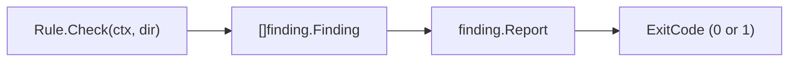
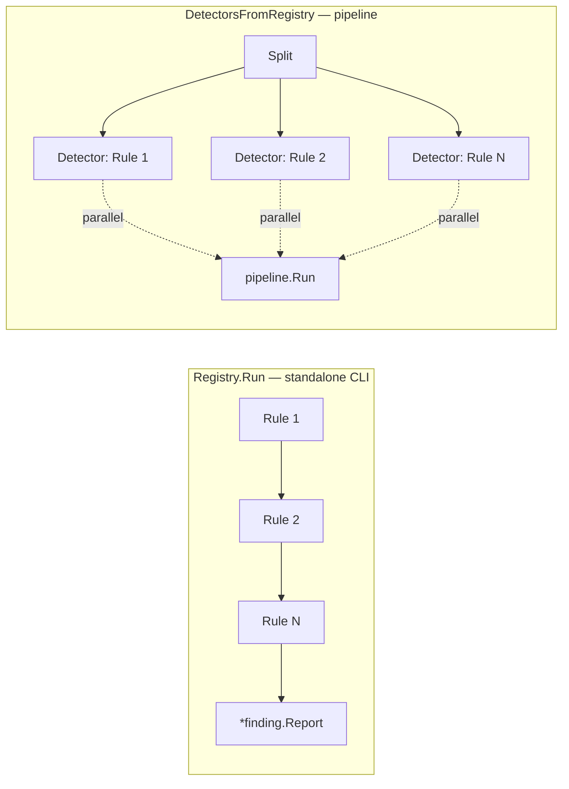

# go-linter-sdk

**A small Go library for building linters that plug into a [`finding`](https://github.com/larsartmann/go-finding)-based ecosystem.**

Every Go linter reinvents the same scaffolding — a rule interface, a registry, and a converter that bridges the linter's own issue type to the ecosystem's finding type. `go-linter-sdk` standardizes the first two and **eliminates the third**: rules emit `finding.Finding` directly, so there is no converter layer to maintain. A linter that adopts it ships a `rules.go` and a `main.go` one-liner; the registry, detector adapters, error attribution, and exit codes are shared.

[](https://pkg.go.dev/github.com/larsartmann/go-linter-sdk)
[](https://github.com/larsartmann/go-linter-sdk/actions/workflows/ci.yml)
[](LICENSE)

**[pkg.go.dev](https://pkg.go.dev/github.com/larsartmann/go-linter-sdk)**

> **Status: Early, adopted, proven.** The `Rule`/`Registry`/`Detector` core is stable and tested (100% library coverage measured 2026-11-19, race-clean), and six LarsArtmann repositories already import it. The value proposition — eliminating converter code — is **verified at the source level** (2026-10-11): no consumer retains a custom Issue/Violation converter layer; one deleted its violation hierarchy (~4,700 LOC), three were born native. Details and per-repo evidence: [`docs/ADOPTION.md`](docs/ADOPTION.md).

---

## Why?

Every Go linter built on a shared findings format reinvents the same three layers:

| Layer                                   | What it does                                               |
| --------------------------------------- | ---------------------------------------------------------- |
| Rule interface                          | Declares a check's identity + `Check` function             |
| Registry                                | Holds rules, drives execution                              |
| **Issue → `finding.Finding` converter** | **Bridges the linter's native type to the ecosystem type** |

The third row is the killer. When a linter's own issue type predates the ecosystem's `finding.Finding`, every new finding field means touching the converter. Every refactor cascades. In the LarsArtmann ecosystem this duplication is concrete:

|                                             | branching-flow | erraudit      | go-structure-linter                    |
| ------------------------------------------- | -------------- | ------------- | -------------------------------------- |
| Rule interface                              | custom         | custom        | custom                                 |
| Registry                                    | custom         | custom        | custom                                 |
| **Violation → `finding.Finding` converter** | **1,871 LOC**  | **1,214 LOC** | **0** (`type Issue = finding.Finding`) |

`go-structure-linter` got it rightest by aliasing `Issue = finding.Finding` — no converter at all. **`go-linter-sdk` codifies that pattern.** A rule emits `finding.Finding` directly via `finding.NewBuilder(...)`, so there is no intermediate type to convert.

> The three linters in the table above are LarsArtmann-internal repositories; they are cited as evidence, not as installable consumers. Several of them — and other internal repos — now import `go-linter-sdk` directly; see [Consumers](#consumers).

---

## Installation

```bash
go get github.com/larsartmann/go-linter-sdk
```

Requires Go 1.27+ and [`go-finding`](https://github.com/larsartmann/go-finding) (see `go.mod` for the pinned version).

---

## Companion libraries

`go-linter-sdk` is deliberately a library: it stops at emitting findings, building the report, and mapping it to an exit code. It ships no CLI framework and no formatters, so your binary stays free to choose them. These sibling libraries cover the layers above it:

| Layer                                                | Library                                                                          |
| ---------------------------------------------------- | -------------------------------------------------------------------------------- |
| Findings model, report, JSON/SARIF serialization     | [`go-finding`](https://github.com/larsartmann/go-finding) (already a dependency) |
| Report rendering (tables, Markdown, 16 formats)      | [`go-output`](https://github.com/larsartmann/go-output)                          |
| CLI shell (flags, DI, graceful shutdown, exit codes) | [`cmdguard/v4`](https://github.com/larsartmann/cmdguard)                         |

A typical linter binary combines all three: rules from `go-linter-sdk`, `registry.Run` for the report, cmdguard for flags and lifecycle, and go-output — or go-finding's built-in `report.PrettyJSON()` / `report.ToSARIF()` — for output.

---

## Quick Start

Three steps from zero to a running linter:

1. **Install** — `go get github.com/larsartmann/go-linter-sdk` (requires Go 1.27+ and a recent `go-finding`; see `go.mod`)
2. **Define rules** — write `linter.RuleFunc{Meta: ..., Run: ...}` that emits `finding.Finding` directly
3. **Run** — `registry.Run(ctx, dir)` + `linter.ExitCodeFromReport(report)`

A complete runnable example is at [`examples/minimal-linter`](examples/minimal-linter). See [Usage](#usage) below for the full walkthrough.

---

## Usage

### A minimal linter

```go
package main

import (
    "context"
    "fmt"
    "os"

    "github.com/larsartmann/go-finding"
    "github.com/larsartmann/go-linter-sdk"
)

const toolName = "my-linter"

func main() {
    var noFmtPrintln linter.RuleFunc

    noFmtPrintln = linter.RuleFunc{
        Meta: linter.RuleMeta{
            ID:          "no-fmt-println",
            Name:        "no fmt.Println in libraries",
            Description: "fmt.Println is banned in libraries; use a logger",
            Cat:         linter.CategoryStyle,
            Sev:         finding.SeverityWarning,
            ToolName:    toolName,
        },
        Run: func(ctx context.Context, dir string) ([]finding.Finding, error) {
            // ... scan dir for fmt.Println; emit findings directly ...
            return []finding.Finding{
                noFmtPrintln.NewFinding(
                    "fmt.Println is banned in libraries; use a logger",
                    finding.Pos(finding.FilePath("example.go"), 1, 1),
                ).WithSuggestion("use a logger instead").MustBuild(),
            }, nil
        },
    }

    registry := linter.NewRegistry(linter.WithToolName(toolName))
    registry.Register(noFmtPrintln)

    report, err := registry.Run(context.Background(), ".")
    if err != nil {
        panic(err) // a rule failed (see "Errors" for attribution)
    }

    fmt.Fprintf(os.Stderr, "%d finding(s), %d file(s) scanned\n",
        report.Len(), report.Summary.FilesScanned)
    os.Exit(linter.ExitCodeFromReport(report))
}
```

> A complete, runnable version lives at [`examples/minimal-linter`](examples/minimal-linter) — run it with `go run ./examples/minimal-linter [dir]`.
>
> `rule.NewFinding(message, pos)` pre-fills the rule ID, tool name, severity, and category from `RuleMeta` — set identity once, not per finding.

### Plug into BuildFlow's DAG (toolsdk recipe)

BuildFlow consumes tools declaratively via `toolsdk.Spec` — the same module the fleet's own tools register through. A registry-based linter wires in with ~10 lines:

```go
package mylinter

import (
    "github.com/larsartmann/go-finding"
    "github.com/larsartmann/go-finding/toolsdk"
    "github.com/larsartmann/go-linter-sdk"
)

// NewDetector returns the BuildFlow-facing detector for this linter.
func NewDetector() finding.Detector {
    registry := linter.NewRegistry(linter.WithToolName("my-linter"))
    registry.Register(noFmtPrintln) // your RuleFunc

    return linter.DetectorFromRegistry(registry, "my-linter")
}

func init() {
    toolsdk.Register(toolsdk.Spec{
        Name:        "my-linter",
        Description: "bans fmt.Println in libraries",
        Trigger:     toolsdk.Trigger{Files: []string{"**/*.go"}, Language: "go"},
        Detect:      NewDetector(),
    })
}
```

Registration happens at `init()` time; the host binary imports the rule
package for its side effect (the blank import):

```go
import _ "example.com/mylinter" // registers its toolsdk.Spec at init
```

The detector reads the working directory from the context
(`finding.WorkingDirFromContext`), so module fan-out and per-directory runs
work transparently. The returned detector also implements
`finding.DetectorV2`, so BuildFlow receives coverage evidence
(`FilesScanned` / `SkippedModules`) from `CoverageReporter` rules and
host-portable finding IDs (see below).

### Plug into go-finding/pipeline (per-rule parallelism)

```go
detectors := linter.DetectorsFromRegistry(registry)
// Pass `detectors` to pipeline.New(config, rootDir, detectors...) for
// per-detector parallelism, timeouts, error isolation, and metrics.
//
// Unlike DetectorFromRegistry (which collapses all rules into one opaque
// detector), each detector is named after the rule's ID — the pipeline
// attributes timing and errors to individual rules.
```

Both adapters also implement `finding.DetectorV2`, so hosts using
`finding.RunDetect` receive coverage evidence alongside findings.

### Coverage evidence and portable finding IDs

Every execution path normalizes findings through `finding.Relativize` against
the target directory, so finding IDs are stable whether the target was absolute
or relative — IDs never embed host paths like `/home/...`.

Rules that can measure their own scan coverage implement the optional
`CoverageReporter` interface; the report then carries real evidence
(`Summary.FilesScanned` / `Summary.SkippedModules`) instead of a meaningless
zero:

```go
type goFilesRule struct {
    linter.RuleFunc
    scanned int
}

func (r *goFilesRule) Coverage(_ context.Context, _ string) (int, []string) {
    return r.scanned, nil
}
```

### Building findings with Confidence and FixStrategy

Each finding carries its own `Confidence` and `FixStrategy`, set by chaining
on the builder `rule.NewFinding(...)` returns. This is strictly more expressive
than rule-level defaults: a single rule can emit findings with different
confidence levels and fix strategies depending on the matched pattern.

```go
return []finding.Finding{
    rule.NewFinding("unused variable", pos).
        WithConfidence(finding.ConfidenceHigh).
        WithFixStrategy(finding.FixStrategyDirect).
        MustBuild(),
}, nil
```

| `Confidence`       | When to use                            |
| ------------------ | -------------------------------------- |
| `ConfidenceLow`    | Heuristic match; may be false positive |
| `ConfidenceMedium` | Likely a real issue                    |
| `ConfidenceHigh`   | Definitely a real issue                |

| `FixStrategy`        | Meaning                       |
| -------------------- | ----------------------------- |
| `FixStrategyNone`    | No fix available              |
| `FixStrategySuggest` | Suggest a fix in output       |
| `FixStrategyDirect`  | Can auto-fix programmatically |
| `FixStrategyAI`      | Requires AI to generate a fix |

### Applying fixes (host-side)

The SDK **declares** fixes, it never applies them (ADR 0002): a rule that
knows a safe mechanical edit attaches `TextEdit` list to the finding at
emission time, and the finding is then authoritative for its own fix.

```go
return []finding.Finding{
    rule.NewFinding("redundant nil guard", pos).
        WithConfidence(finding.ConfidenceHigh).
        WithFixStrategy(finding.FixStrategyDirect).            // machine-applicable
        WithEdits(finding.TextEdit{                            // variadic
            Start:   finding.Pos(file, guardLine, 1),
            End:     finding.Pos(file, nilRetLine+1, 1),       // exclusive
            NewText: "return oops.Wrap(err)",
        }).
        MustBuild(),
}, nil
```

See `examples/oops-redundant-guard` for a complete rule that declares one
`TextEdit` per finding. **Application is host-side, three lanes:**

1. **Simple host:** `finding.ApplySimpleFixes(findings)` (go-finding root
   module) applies one text replacement per finding and refuses multi-edit
   findings rather than half-applying them.
2. **go-finding/pipeline:** the pipeline module's `FixApplier` handles
   multi-edit `Edits` lists inside a detect → fix → verify loop, with
   per-finding outcomes.
3. **go-finding/toolsdk:** BuildFlow-integrated linters can expose a
   `Repairer` so the orchestrator's fix steps run the linter's own repair
   logic; see the toolsdk module docs.

Which lane fits depends on your host: pick (1) for CLI auto-fix on
single-edit findings, (2) for pipeline-orchestrated remediation, (3) when
BuildFlow drives the loop.

### Data flow

Rules emit `finding.Finding` directly — no intermediate type. The SDK aggregates, reports, and maps to exit codes:



```
Rule.Check(ctx, dir) → []finding.Finding → Report → ExitCode (0 clean / 1 findings)
```

### Two execution paths

The SDK offers two ways to run rules. Pick based on your integration target:



<details>
<summary>ASCII fallback (for pkg.go.dev)</summary>

```
Registry.Run (standalone CLI):     Rule 1 → Rule 2 → Rule N → *finding.Report
DetectorsFromRegistry (pipeline): Split → [Detector: Rule 1 | Rule 2 | Rule N] → pipeline.Run
```

</details>

|                    | `Registry.Run`                             | `DetectorsFromRegistry`                   |
| ------------------ | ------------------------------------------ | ----------------------------------------- |
| **Execution**      | Sequential                                 | Parallel (one goroutine per rule)         |
| **Failure policy** | Fail-fast (default) or `ContinueOnError()` | Per-detector isolation (pipeline handles) |
| **Granularity**    | Single opaque run                          | Per-rule detectors with named metrics     |
| **Best for**       | Simple CLI linters                         | go-finding/pipeline, BuildFlow DAG        |

---

## Registry patterns

Three registration patterns cover every consumer seen so far:

**1. Init-time (the common case).** All rules registered at startup; duplicates
or bad metadata crash loudly, which is what you want for first-party rules:

```go
registry := linter.NewRegistry(linter.WithToolName("my-linter"))
registry.Register(myRule)      // panics on duplicate ID / missing identity fields
registry.Register(optInRule())
```

**2. Plugin / opt-in rules.** Noisy or experimental rules stay disabled by
default and are enabled by name via [FilterRules](#api):

```go
rules := linter.FilterRules(allRules, enableSet, disableSet)
for _, r := range rules {
    registry.Register(r)
}
```

**3. Dynamic Deregister.** A long-running host (LSP server, watch mode) can
remove rules at runtime; `Deregister(id)` is safe to call concurrently with
`Run` (runs take a snapshot of the rule list). `Has(id)` / `Get(id)` answer
lookup questions by stable ID:

```go
if registry.Has("my-rule") {
    registry.Deregister("my-rule")
}
```

For the reasoning behind Register's panic-on-duplicate contract, see
[docs/decisions/2026-09-09_register-panic-vs-error.md](docs/decisions/2026-09-09_register-panic-vs-error.md).

---

## API

### Types

| Type              | Purpose                                                                                                                           |
| ----------------- | --------------------------------------------------------------------------------------------------------------------------------- |
| `Rule` interface  | `ID()` / `Name()` / `Description()` / `Category()` / `Severity()` / `IsEnabledByDefault()` / `Check(ctx, dir) ([]Finding, error)` |
| `RuleFunc` struct | Adapter: combines a `RuleMeta` header with a `Run` closure to satisfy `Rule`. Enabled by default.                                 |
| `RuleMeta` struct | Declarative identity: `ID` (required, stable), `Name`, `Description`, `Cat`, `Sev`                                                |
| `Category`        | Open `string` type. 11 recommended values (`CategoryDesign`, ...); define your own for domain-specific taxonomies                 |
| `Registry`        | Holds rules; thread-safe with `sync.RWMutex`                                                                                      |
| `RuleSet`         | Immutable, order-preserving rule collection with O(1) ID lookup; mutex-free `Check` + `ToRegistry` conversion                      |
| `Filter`          | Severity/category gate over findings (`Keep`/`Apply`); zero value keeps everything                                                 |
| `CoverageReporter`| Optional `Rule` extension: `Coverage(ctx, dir)` reports files-scanned/skipped-modules evidence into the report                     |

### Functions

| Function                            | Returns                  | Purpose                                                                                               |
| ----------------------------------- | ------------------------ | ----------------------------------------------------------------------------------------------------- |
| `NewRegistry(opts…)`                | `*Registry`              | Empty registry; pass `WithToolName(...)` to stamp tool name onto findings                             |
| `WithToolName(name)`                | `RegistryOption`         | Stamp the tool name onto all findings and the report                                                  |
| `(*Registry).Register(rule)`        | —                        | Add a rule (panics on duplicate ID or empty identity fields)                                          |
| `(*Registry).All()`                 | `[]Rule`                 | Snapshot of registered rules                                                                          |
| `(*Registry).Get(id)`               | `Rule, bool`             | Lookup by stable ID                                                                                   |
| `(*Registry).Has(id)`               | `bool`                   | Check if a rule ID is registered                                                                      |
| `(*Registry).Deregister(id)`        | `bool`                   | Remove a rule by ID (returns true if found)                                                           |
| `(*Registry).Run(ctx, dir, opts…)`  | `*finding.Report, error` | Run all rules; aggregate findings. Fail-fast by default; pass `ContinueOnError()` for partial results |
| `ContinueOnError()`                 | `RunOption`              | Run option: continue past rule failures, collect partial findings, join errors                        |
| `DetectorFromRegistry(r, toolName)` | `finding.Detector`       | Adapt registry to a single Detector (BuildFlow DAG)                                                   |
| `DetectorsFromRegistry(r)`          | `[]finding.Detector`     | One Detector per rule (go-finding/pipeline: per-rule parallelism, timeouts, error isolation)          |
| `ExitCodeFromReport(report)`        | `int`                    | 0 if clean, 1 if findings — the ecosystem exit-code convention                                        |
| `ExitCodeByConfidence(report, thr)` | `int`                    | 0 clean / 1 at-or-above threshold / 2 below threshold (triage mode)                                   |
| `ExitCodeFromFindings(findings)`    | `int`                    | Same binary convention for a plain `[]finding.Finding`, no Report needed                              |
| `FilterRules(all, enable, disable)` | `[]RuleFunc`             | Standard --enable/--disable filtering for CLI and plugin entry points                                 |
| `SelectRules(all, enable, disable)` | `[]Rule`                 | Same --enable/--disable logic for a `[]Rule` slice; OptIn-wrapped rules ride through (no unexported-wrapper problem) |
| `Filter{MinSeverity, Categories}`   | (type) `Keep` / `Apply`  | Severity/category-based finding filtering; zero value keeps everything, input never mutated           |
| `NewRegistryFromRules(rules, opts)` | `*Registry`              | Bulk constructor with the same validation as per-rule `Register`                                      |
| `RuleSet` (type)                    | `NewRuleSet`, `Check`, `ToRegistry` | Immutable, order-preserving, mutex-free rule collection with O(1) ID lookup                 |
| `CoverageReporter` (optional iface) | `Coverage()` returns file counts | Rules that report `filesScanned`/`skippedModules`; `Run` feeds them into the report — real coverage evidence per finding run |
| `AllCategories()`                   | `[]Category`             | Fresh copy of the eleven recommended categories                                                       |
| `OptIn(rf)`                         | `Rule`                   | Wrap a `RuleFunc` as disabled-by-default (opt-in rule; runs only with explicit `--enable <id>`)       |
| `RuleFunc.NewFinding(msg, pos)`     | `*finding.Builder`       | Pre-stamped builder from rule metadata (rule ID, tool name, severity, category)                       |
| `RuleMeta.Validate()`               | `error`                  | Check required fields (ID, Name, Description, Cat) before construction                                |

### Errors

Rule failures are wrapped so you can attribute them: `errors.AsType[*RuleError](err)`
extracts the failing rule's ID; `errors.Is(err, ErrRuleFailed)` is the boolean
check. In `ContinueOnError()` mode, `Registry.Run` joins failures from multiple
rules — `RuleErrors(err)` recovers them all:

```go
report, err := registry.Run(ctx, dir, linter.ContinueOnError())
for _, ruleErr := range linter.RuleErrors(err) {
    fmt.Fprintf(os.Stderr, "rule %s failed: %v\n", ruleErr.RuleID, ruleErr.Cause)
}
```

| Symbol              | Purpose                                                           |
| ------------------- | ----------------------------------------------------------------- |
| `*RuleError`        | Wraps a rule failure; `RuleID` names the failing rule             |
| `RuleErrors(err)`   | Extract every `*RuleError` from a joined or wrapped error         |
| `ErrRuleFailed`     | Sentinel matched by `errors.Is` for any rule failure              |
| `NewRuleError(...)` | Wrap a cause as a `*RuleError` when implementing your own runner  |
| `ErrMissingFields`  | Sentinel wrapped into `Register`'s panic on empty identity fields |

---

## Design notes

- **Depends only on `go-finding`** (the ecosystem hub) so any consumer — CLI, library, LSP server, golangci-lint plugin — can adopt it without coupling.
- **Rules emit `finding.Finding` directly.** No intermediate Violation/Issue type. No converter layer. This is the core design decision.
- **Dual identity: `ID()` + `Name()`.** `ID()` is the stable identifier (never changes, used for dedup/suppression/filtering); `Name()` is the display name (mutable). Every rule must declare an explicit ID.
- **`Category` is an open type.** The 11 built-in constants are recommendations. Define your own for domain-specific taxonomies: `linter.Category("api")`.
- **`Registry.Register` panics on duplicate IDs or empty identity fields** — duplicate or missing rule IDs/Names/Descriptions/Categories are programming errors that should surface at startup.
- **Two execution paths.** `Registry.Run` for standalone CLI (sequential, fail-fast or `ContinueOnError`); `DetectorsFromRegistry` for go-finding/pipeline (parallel, per-rule isolation).
- **Per-finding Confidence and FixStrategy.** Use `finding.NewBuilder(...).WithConfidence(...).WithFixStrategy(...)` to set these per finding — more expressive than rule-level defaults.
- **`ExitCodeFromReport` is binary** (0 clean / 1 any findings). The ecosystem convention; tools that want severity-tiered exit codes do their own mapping.

---

## Migration path

**Full walkthrough with measured numbers: [docs/migration-guide.md](docs/migration-guide.md).**

Existing linters migrate **incrementally** — one rule at a time:

1. Add `go-linter-sdk` as a dependency
2. Pick one rule; convert its native type to emit `finding.Finding` via `finding.NewBuilder(...)`
3. Wrap it in `linter.RuleFunc{Meta: ..., Run: ...}` and `Register` it
4. Repeat for each rule
5. Once all rules are migrated, delete the converter package (`pkg/finding/` in branching-flow / erraudit)

Each step compiles and runs independently. No big-bang migration.

---

## Consumers

Example consumers in this repo:

- `examples/minimal-linter` — minimal linter proving the Rule → `finding.Finding` path
- `examples/no-go-mod` — pilot port of `go-structure-linter`'s `NoGoModRule`
- `examples/naked-return-guard` — pilot port of `branching-flow`'s `nakedreturn` rule (156 LOC of analyzer + Detection type + converter became one self-contained `RuleFunc`)
- `examples/oops-redundant-guard` — pilot port of `erraudit`'s `oops_redundant_guard` rule (detection core + go/analysis autofixer + violation bridge became one self-contained `RuleFunc`)
- `examples/cli-triage` — discovery + triage demo: `FilterRules` (--enable/--disable), `OptIn` gating, tiered exit codes (0 clean / 1 must-fix / 2 triage / 3 tool failure)

Exit contract for the example tier: every example exits 0 on a clean tree and
non-zero on findings; `cli-triage` owns the full contract — `0` clean,
`1` must-fix findings, `2` triage-only findings, `3` tool failure — so CI can
distinguish "findings below threshold" from "the tool crashed".

Direct consumers in the LarsArtmann ecosystem (verified 2026-10-11; integration
pattern and converter status per repo in [`docs/ADOPTION.md`](docs/ADOPTION.md)):

- `go-structure-linter` — the original pilot target
- `samber-linter`
- `go-humanize-linter`
- `cmdguard/lint` — the CLI-framework sibling's lint submodule
- `project-meta/linter`
- `BuildFlow/execution` — the orchestrator depends on the SDK directly

Roughly 60 further modules import it indirectly. The core promise — no consumer
retains a custom Issue/Violation converter layer — holds across all six direct
consumers, verified at the source level on 2026-10-11: three were born native,
two physically deleted their converter code, one keeps a documented
`go/analysis` integration by design.

## Status

Early but adopted. The `Rule`/`Registry`/`Detector` core is stable, and the
migration story is proven twice over: by the pilot ports under
[`examples/`](examples/) and, since 2026-10-11, by source-level verification
that no direct consumer retains a custom Issue/Violation converter layer (see
[Consumers](#consumers) and [`docs/ADOPTION.md`](docs/ADOPTION.md)).

## Project docs

Deeper material lives under [`docs/`](docs/):

| Doc | What it holds |
| --- | --- |
| [`docs/DOMAIN_LANGUAGE.md`](docs/DOMAIN_LANGUAGE.md) | Ubiquitous-language glossary: Rule, Registry, dual identity, what is deliberately NOT here |
| [`docs/migration-guide.md`](docs/migration-guide.md) | Step-by-step migration from a hand-rolled linter (converter deletion) |
| [`docs/ADOPTION.md`](docs/ADOPTION.md) | Consumer adoption evidence, verdicts, and the refresh procedure |
| [`docs/review/libs/index.html`](docs/review/libs/index.html) | Library utilization reviews (one `.md` per first-party dependency, scored) |
| [`TODO_LIST.md`](TODO_LIST.md) / [`ROADMAP.md`](ROADMAP.md) | Open work items / long-term direction |

## Support & security

Open repository: issues and PRs from anyone are welcome, maintained
best-effort with no SLAs — see [SUPPORT.md](SUPPORT.md). Vulnerabilities go
through private advisories, never public issues — see [SECURITY.md](SECURITY.md).

## License

MIT — see [LICENSE](LICENSE).
