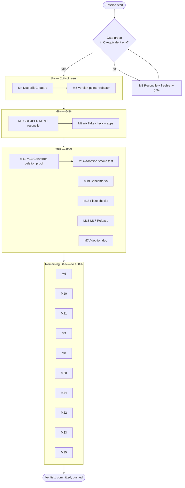

# Pareto Execution Plan — Drift Elimination & Adoption Proof

- **Created:** 2026-10-11 07:36 CEST
- **Repo:** `go-linter-sdk`
- **Basis:** the 2026-10-11 session self-review
  (`docs/status/2026-10-11_07-11_session-self-review-and-status.md`) and its
  50-item "next" list, consolidated and re-ranked by impact bootstrapped by
  effort.
- **Format note:** the user explicitly requested a `.md` file with a
  mermaid/d2 execution graph. The Pareto-planning skill's canonical output is
  HTML; the explicit instruction wins and is not propagated as a new default.

---

## 0. Context — why this plan exists

This session found **two real defects and one structural cause**:

1. **Doc drift (the dominant defect).** The dependency version was written in
   six-plus living docs; every one of them was stale
   (`v1.4.1`/`v1.10.0` vs the real `v1.14.0`; Go 1.26.7 vs 1.27). The CHANGELOG
   was missing five releases. This is a _mechanism_, not an incident — it has
   recurred across many sessions.
2. **Obsolescent scaffolding.** `GOEXPERIMENT=jsonv2` is no longer required
   (Go 1.27 enables `encoding/json/v2` by default; `GOEXPERIMENT=none` now
   breaks the build). Cleanup is mid-flight and partially split with a
   concurrent session.
3. **Unproven core claim.** Six repos import the SDK, but no consumer has been
   verified to have deleted its converter package — the SDK's entire reason to
   exist.

The Pareto logic below targets the **mechanism** first (a guard), because a
mechanism fix compounds; then the **obsolescence** and **verification** gaps;
then the **delivery** and hygiene tail.

---

## 1. Pareto breakdown

### The 1% that delivers 51%

> **A doc-drift CI guard + a one-time version-pointer refactor.**

Root cause of the biggest defect class is prose that duplicates `go.mod`. One
CI check that fails when a living doc disagrees with `go.mod`, plus converting
hardcoded versions to "see `go.mod`" pointers, structurally ends the drift
family — every future session inherits the fix. **M4 + M5.**

### The 4% that delivers 64%

> **1% + GOEXPERIMENT reconciliation + a CI-matching gate.**

Adds: confirm the GOEXPERIMENT cleanup left no mixed state (**M3**), and prove
the repo green in a CI-equivalent environment rather than a dev shell that
masked the truth (**M1**, **M2**). This is "make the docs true and keep them
true, and prove the build the way CI sees it."

### The 20% that delivers 80%

> **4% + adoption proof + delivery + regression safety.**

Adds: verify converter-package deletion in the consumers (**M11–M13**, **M14**),
re-run benchmarks (**M19**), add flake `checks` (**M18**), cut the next release
(**M15–M17**), and capture adoption durably (**M7**). This is the full "the
project is honest, current, and shipped" bundle.

### The remaining 80% (to reach 100%)

Everything else: per-release CHANGELOG depth, doc number refreshes, CONTRIBUTING
reconciliation, dependabot sweep, report archiving/annotation, ROADMAP
decisions, process/script hardening, and metrics. Necessary for completeness,
low marginal leverage. **M8–M10, M20–M25 and the "Other 20%" list.**

---

## 2. Comprehensive plan (medium granularity, 30–100 min, ≤27 tasks)

Sorted by importance / impact / effort / customer-value. **Pareto tier** column
shows 1% / 4% / 20% / tail.

| ID  | Task                                                                  | Tier | Impact   | Effort | Value          | ~min |
| --- | --------------------------------------------------------------------- | ---- | -------- | ------ | -------------- | ---- |
| M4  | Implement doc-drift CI guard (+ local script)                         | 1%   | Critical | M      | Ecosystem-wide | 90   |
| M5  | Refactor all prose version refs to "see `go.mod`" pointers            | 1%   | Critical | M      | Ecosystem-wide | 60   |
| M3  | Confirm GOEXPERIMENT cleanup is complete & consistent repo-wide       | 4%   | High     | M      | Internal       | 60   |
| M1  | Reconcile concurrent-session changes + full fresh-env gate            | 4%   | High     | M      | Internal       | 60   |
| M2  | Re-run `nix flake check` + `nix run .#test/#lint/#build` post-edit    | 4%   | High     | S/M    | Internal       | 45   |
| M11 | Verify converter-package deletion in `go-structure-linter`            | 20%  | Critical | M      | Core claim     | 90   |
| M12 | Verify converter deletion in `samber-linter` + `go-humanize-linter`   | 20%  | High     | M      | Core claim     | 90   |
| M13 | Verify converter deletion in `cmdguard/lint` + `project-meta/linter`  | 20%  | High     | M      | Core claim     | 90   |
| M19 | Re-run benchmarks; diff vs `reports/benchmarks-baseline.txt`          | 20%  | High     | S/M    | Regression     | 45   |
| M18 | Add flake `checks` for `go test`, `go vet`, `golangci-lint`           | 20%  | Medium   | M      | CI parity      | 90   |
| M15 | Decide next version label + draft next-release CHANGELOG              | 20%  | High     | S/M    | Delivery       | 45   |
| M16 | Pre-release verification (fresh clone, proxy get, stranger test)      | 20%  | High     | M      | Delivery       | 90   |
| M17 | Tag + push the release; verify pkg.go.dev                             | 20%  | High     | M      | Delivery       | 60   |
| M7  | Build durable consumer-adoption doc                                   | 20%  | Medium   | S/M    | Adoption       | 45   |
| M14 | Add adoption smoke test to CI stranger-test job                       | 20%  | Medium   | M      | Verification   | 60   |
| M6  | Reconcile the HTML status report with the GOEXPERIMENT pivot          | tail | Medium   | S      | Docs           | 30   |
| M10 | Refresh all coverage/verification numbers in living docs              | tail | Medium   | S      | Docs           | 30   |
| M21 | Script the bump checklist                                             | tail | Medium   | M      | Process        | 60   |
| M9  | Reconcile CONTRIBUTING/README/FEATURES with final dependency story    | tail | Medium   | S/M    | Docs           | 45   |
| M8  | Enumerate CHANGELOG entries v1.11–v1.14 individually                  | tail | Medium   | M      | Docs           | 60   |
| M20 | Add a benchmark step to CI (or a documented manual gate)              | tail | Medium   | M      | Quality        | 60   |
| M24 | Resolve/annotate ROADMAP Q2/Q3; add parallel-session hazard to AGENTS | tail | Medium   | M      | Decision       | 60   |
| M22 | Sweep dependabot PRs; close superseded                                | tail | Low      | S/M    | Cleanup        | 45   |
| M23 | Archive superseded status reports; annotate old ones                  | tail | Low      | S/M    | Cleanup        | 45   |
| M25 | Track version-distribution + adoption metrics                         | tail | Low      | S/M    | Process        | 45   |

Count: 25 medium tasks (≤27). All report items (b/c/f) are represented; mapping
in §5.

---

## 3. Detailed breakdown (fine granularity, ≤12 min, includes ALL todos)

| ID  | Task                                                         | Parent | Impact   | ~min |
| --- | ------------------------------------------------------------ | ------ | -------- | ---- |
| F1  | `git status`; list every unexpected file                     | M1     | High     | 5    |
| F2  | Read diffs of concurrently-changed files; judge on merits    | M1     | High     | 12   |
| F3  | Fresh-env `go build ./...`                                   | M1     | High     | 5    |
| F4  | Fresh-env `go vet ./...`                                     | M1     | High     | 5    |
| F5  | Fresh-env `go test ./... -count=1`                           | M1     | High     | 8    |
| F6  | Fresh-env `go test ./... -race -count=1`                     | M1     | High     | 10   |
| F7  | `golangci-lint run ./...`                                    | M1     | High     | 8    |
| F8  | `GOWORK=off go mod tidy` + diff go.mod/go.sum                | M1     | High     | 8    |
| F9  | `nix flake check --no-build`                                 | M2     | High     | 10   |
| F10 | `nix flake check` (build derivation)                         | M2     | High     | 12   |
| F11 | `nix run .#test`                                             | M2     | High     | 10   |
| F12 | `nix run .#lint`                                             | M2     | High     | 10   |
| F13 | `nix run .#build`                                            | M2     | Medium   | 8    |
| F14 | Grep whole tree for `GOEXPERIMENT` / `jsonv2`                | M3     | High     | 8    |
| F15 | List each remaining occurrence as `file:line`                | M3     | High     | 8    |
| F16 | Decide "standard package" vs "default-on experiment" wording | M3     | Medium   | 5    |
| F17 | Fix each stale occurrence                                    | M3     | High     | 12   |
| F18 | Re-grep to confirm zero stale occurrences                    | M3     | High     | 5    |
| F19 | Design guard: which docs, which version keys to compare      | M4     | Critical | 12   |
| F20 | Write `scripts/check-doc-versions.sh`                        | M4     | Critical | 12   |
| F21 | Test guard locally (one pass case, one fail case)            | M4     | Critical | 10   |
| F22 | Add CI job invoking the guard                                | M4     | Critical | 10   |
| F23 | Document the guard in AGENTS.md / CONTRIBUTING.md            | M4     | High     | 8    |
| F24 | Inventory all version strings in living docs                 | M5     | Critical | 10   |
| F25 | Rewrite AGENTS.md version refs → `go.mod` pointer            | M5     | Critical | 10   |
| F26 | Rewrite README.md version refs                               | M5     | High     | 8    |
| F27 | Rewrite ROADMAP.md + DOMAIN_LANGUAGE.md refs                 | M5     | High     | 10   |
| F28 | Rewrite migration-guide + CONTRIBUTING refs                  | M5     | High     | 8    |
| F29 | Grep-verify no hardcoded versions remain in living docs      | M5     | High     | 5    |
| F30 | Re-read HTML report sections a–f                             | M6     | Medium   | 10   |
| F31 | Patch narrative for the GOEXPERIMENT pivot                   | M6     | Medium   | 12   |
| F32 | Validate HTML well-formedness                                | M6     | Medium   | 8    |
| F33 | Draft adoption-doc structure                                 | M7     | Medium   | 8    |
| F34 | Fill 6 consumers + pinned versions                           | M7     | Medium   | 10   |
| F35 | Add refresh procedure to the doc                             | M7     | Low      | 8    |
| F36 | Read module-cache diff for v1.11                             | M8     | Medium   | 8    |
| F37 | Read module-cache diff for v1.12                             | M8     | Medium   | 8    |
| F38 | Read module-cache diff for v1.13                             | M8     | Medium   | 8    |
| F39 | Read module-cache diff for v1.14                             | M8     | Medium   | 8    |
| F40 | Write four per-release CHANGELOG entries                     | M8     | Medium   | 12   |
| F41 | Re-read CONTRIBUTING against final dependency story          | M9     | Medium   | 8    |
| F42 | Patch CONTRIBUTING                                           | M9     | Medium   | 8    |
| F43 | Patch FEATURES dependency/tooling rows                       | M9     | Medium   | 10   |
| F44 | Re-measure library-only coverage                             | M10    | Medium   | 8    |
| F45 | Re-measure `./...` coverage                                  | M10    | Medium   | 5    |
| F46 | Update all numbers in living docs                            | M10    | Medium   | 10   |
| F47 | Open/clone `go-structure-linter`                             | M11    | Critical | 5    |
| F48 | Locate its converter/bridge package                          | M11    | Critical | 10   |
| F49 | Determine whether the SDK import replaced it                 | M11    | Critical | 10   |
| F50 | Search for remaining custom Issue types                      | M11    | Critical | 10   |
| F51 | Record verdict with file evidence                            | M11    | Critical | 10   |
| F52 | Inspect `samber-linter` bridge                               | M12    | High     | 12   |
| F53 | Inspect `go-humanize-linter` bridge                          | M12    | High     | 12   |
| F54 | Record both verdicts                                         | M12    | High     | 8    |
| F55 | Inspect `cmdguard/lint` bridge                               | M13    | High     | 12   |
| F56 | Inspect `project-meta/linter` bridge                         | M13    | High     | 12   |
| F57 | Record both verdicts                                         | M13    | High     | 8    |
| F58 | Design the smoke-test module                                 | M14    | Medium   | 10   |
| F59 | Add it to the CI stranger-test job                           | M14    | Medium   | 12   |
| F60 | Verify the job runs green                                    | M14    | Medium   | 10   |
| F61 | Decide the version label (with user)                         | M15    | High     | 8    |
| F62 | Draft the next-release CHANGELOG section                     | M15    | High     | 12   |
| F63 | Fresh clone + proxy-only `go get @latest`                    | M16    | High     | 12   |
| F64 | Build + run the hello-linter                                 | M16    | High     | 12   |
| F65 | Run full gate on the tag commit                              | M16    | High     | 12   |
| F66 | Create the annotated tag                                     | M17    | High     | 8    |
| F67 | Push the tag                                                 | M17    | High     | 8    |
| F68 | `go get` the new tag to trigger the proxy                    | M17    | High     | 8    |
| F69 | Verify pkg.go.dev renders `@latest`                          | M17    | Medium   | 10   |
| F70 | Add flake `checks` derivations                               | M18    | Medium   | 12   |
| F71 | Verify `nix flake check` picks them up                       | M18    | Medium   | 10   |
| F72 | Run benchmarks                                               | M19    | High     | 10   |
| F73 | Diff results vs baseline                                     | M19    | High     | 8    |
| F74 | Update baseline if improved                                  | M19    | Medium   | 5    |
| F75 | Add a benchmark CI step (or documented gate)                 | M20    | Medium   | 12   |
| F76 | Write `scripts/bump-checklist.sh` (or a doc)                 | M21    | Medium   | 12   |
| F77 | `gh pr list`                                                 | M22    | Low      | 5    |
| F78 | Close superseded dependabot PRs                              | M22    | Low      | 10   |
| F79 | Archive superseded status reports                            | M23    | Low      | 10   |
| F80 | Annotate old reports (inline/appendix)                       | M23    | Low      | 12   |
| F81 | Add parallel-session hazard note to AGENTS.md                | M24    | Medium   | 10   |
| F82 | Resolve or annotate ROADMAP Q2/Q3                            | M24    | Medium   | 12   |
| F83 | Record version-distribution + adoption metrics               | M25    | Low      | 12   |

Count: 83 fine tasks (≤150). Every medium task has ≥3 fine subtasks.

---

## 4. Execution graph



D2 source (equivalent) for a richer render:

```d2
start: Session start
gate: Gate green (CI-equivalent)?
start -> gate
gate -> m1: no
m1 -> gate
gate -> tier1: yes

tier1: {
  label: "1% — 51% of result"
  m4: M4 Doc-drift CI guard
  m5: M5 Version-pointer refactor
  m4 -> m5
}
tier4: {
  label: "4% — 64%"
  m3: M3 GOEXPERIMENT reconcile
  m2: M2 nix flake check + apps
  m3 -> m2
}
tier20: {
  label: "20% — 80%"
  m11: M11-M13 Converter-deletion proof
  m14: M14 Adoption smoke test
  m19: M19 Benchmarks
  m18: M18 Flake checks
  m15: M15-M17 Release
  m7: M7 Adoption doc
  m11 -> m14
}
tail: {
  label: "Remaining 80% — to 100%"
  m6: M6 Report reconcile
  m8: M8 CHANGELOG depth
  m9: M9 CONTRIBUTING reconcile
  m10: M10 Number refresh
  m20: M20 Benchmark CI
  m21: M21 Bump checklist script
  m22: M22 Dependabot sweep
  m23: M23 Archive reports
  m24: M24 ROADMAP Q2/Q3
  m25: M25 Metrics
}
tier1 -> tier4
tier4 -> tier20
tier20 -> tail
tail -> done: Verified, committed, pushed
```

---

## 5. Mapping of report items → plan tasks

| Report item                    | Plan task               |
| ------------------------------ | ----------------------- |
| f1 / c1 converter deletion     | M11–M13                 |
| f2 / c2 doc-drift CI guard     | M4                      |
| f3 post-edit `nix flake check` | M2                      |
| f4 `nix run` entrypoints       | M2                      |
| f5 HTML report reconcile       | M6                      |
| f6 / c3 next release           | M15–M17                 |
| f7 / c4 benchmarks             | M19                     |
| f8 version pointers            | M5                      |
| f9 GOEXPERIMENT mixed state    | M3                      |
| f10 / c5 adoption doc          | M7                      |
| f11 CHANGELOG depth            | M8                      |
| f12 / c5 dependabot            | M22                     |
| f13 / c6 flake checks          | M18                     |
| f14 bump checklist             | M21                     |
| f15 CI stale pins              | M5, M24                 |
| f16 CONTRIBUTING               | M9                      |
| f17/f18 ROADMAP Q2/Q3          | M24                     |
| f19 HTML validation            | M6                      |
| f20 adoption smoke test        | M14                     |
| f24 number refresh             | M10                     |
| f25 concurrency check          | M1, M24                 |
| f29 HARVEST to TODO_LIST       | M24                     |
| f44/f48 final gate             | M1, M2                  |
| b1–b6                          | M1, M2, M3, M6, M8, M19 |
| d1–d6 process fixes            | M1, M21, M24            |

---

## 6. "Other 20%" — explicit completeness list

Items needed to reach 100% but low marginal leverage, kept so nothing is lost:

1. FAQ/README polish after adoption rewrite (M9).
2. Badge refresh if any is stale (M10).
3. `docs/DOMAIN_LANGUAGE.md` ongoing vocabulary sync at each bump (M8/M10).
4. pkg.go.dev "Imported by" tracking (M25).
5. Version-distribution snapshot (60/31/3/1) recorded (M25).
6. `go.work*` stays gitignored assertion (M24).
7. Coverage gate ≥90% still enforced in CI (M16).
8. Stranger-test resolves the new tag (M16).
9. CI tidy check green (M16).
10. `go mod verify` green (M1).
11. Examples doc comments consistent with GOEXPERIMENT removal (M3).
12. `.buildflow.yml` matches final GOEXPERIMENT posture (M3).
13. Annotate this plan if superseded (docs-health ANNOTATE).
14. Note the parallel-session hazard durably (M24).
15. Release-cadence note (docs-only vs API) (M15).

---

## 7. Guardrails

- **Do not verschlimmbessern.** Every change must leave the repo verifiably no
  worse. No speculative rewrites.
- **Do not break the build.** Run the gate after every significant change.
- **Concurrency first.** `git status` before each edit phase; re-read any file
  that changed under you before editing it.
- **Mechanism over incidents.** The 1% guard must land before the cosmetic tail;
  otherwise the drift simply returns.

---

_Created 2026-10-11 07:36 — snapshot artifact; living todos live in `TODO_LIST.md`._
