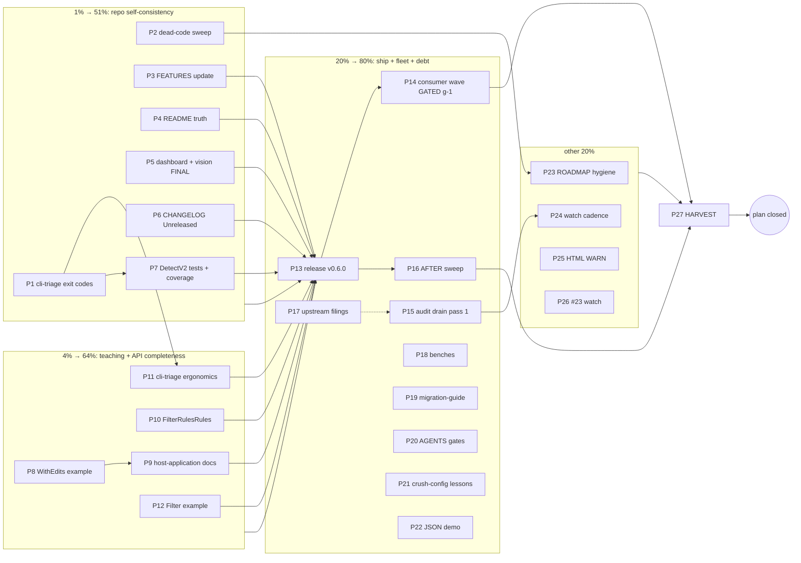

# Pareto Plan — Post-v0.5.0 Truth, Teaching & Fleet (2026-11-19 15:02)

> **Scope:** ALL open work for `go-linter-sdk` as of 2026-11-19 15:02 CET,
> repo HEAD `ad3bf72` (master pushed, CI green; plan-file commit follows):
> TODO_LIST #28–#31 (+ #23 BLOCKED watch), the 14:43 status report's
> d-section fixes (10), e-section improvements (10), and the still-open
> remainder of its f-list (50 items, deduplicated). **Customer** = the 6
> direct consumers + ~60 indirect importers; the secondary customer is the
> repo's own truthfulness (every doc claim measurably true).
>
> **Errata / verification (skill step 0):** prior plan
> `2026-11-19_07-54` is FULLY executed (M1–M27; v0.5.0 tagged `4c86cef`,
> post-release API tier on master `ad3bf72`) — nothing re-dispatched. Every
> task below was verified open THIS SESSION with a live command: CHANGELOG
> has no [Unreleased] entry (read), FEATURES.md lacks all new capabilities
> (grep: 0 hits), README example list omits cli-triage (grep), dashboard
> stat card reads "5/5" against 6 NOT-ADOPTED verdicts (grep), cli-triage
> exits 2 for both triage and tool failure (source I wrote),
> `filterFixture.perm` unused (grep), `unusedItoa` unused (gopls, all
> session), coverage 98.3% vs claimed 98.7% (measured today). The three
> open owner questions (g-1 consumer pushes, g-2 exit-code value, g-3 drain
> mode) are NOT blocking: each has a recommended default and the plan flags
> where a different answer reorders.

## The Pareto thesis

v0.5.0 shipped *report truthfulness to consumers*. The remaining debt is
*repo self-consistency*: ten small fixes that make every claim this repo
makes about itself measurably true (exit codes, dead code, FEATURES,
README, dashboard, coverage, CHANGELOG), then the teaching tier (WithEdits,
FilterRules-rules variant, cli-triage ergonomics), then ship v0.6.0 and
start the fleet/debt passes. The big rock is gone; what is left is polish
with disproportionately high trust value.

## 1) The 1% that delivers 51% — "every claim in this repo is TRUE"

| # | Task | Why it is the 1% |
| --- | --- | --- |
| P1 | cli-triage exit-code contract: tool failure = 3 (≠ triage 2) + tests | CI currently cannot distinguish "tool crashed" from "findings below threshold" — a correctness bug I shipped |
| P2 | Dead-code sweep: `filterFixture.perm`, `unusedItoa`, `itoa` wrapper | Ghost scaffolding in a repo that preaches ghost hunts |
| P3 | FEATURES.md full inventory update (v0.5.0 + master tier) | The feature inventory missed an entire release — worst one-home violation on record here |
| P4 | README truth batch: cli-triage in example list, `CoverageReporter` API row, coverage 98.3% correction | pkg.go.dev froze three stale claims at v0.5.0 |
| P5 | Dashboard truth: 6/6 declines stat + re-shoot + vision re-verify the FINAL PNGs | Verdict-vs-artifact gap from M10 closed properly |
| P6 | CHANGELOG [Unreleased] for the post-release tier + bench numbers | Filter/RuleSet/trio/index shipped with no narrative; F17.5's bench note existed only in chat |
| P7 | Test completeness: DetectV2 error paths, ContinueOnError×CoverageReporter; coverage back ≥ 98.7% | The 98.3% dip is concentrated in untested new paths |

~3.5 h, all local, zero owner input needed. Smallest set that restores
trust in everything the repo says about itself.

## 2) The 4% that delivers 64% — "+ teaching & API completeness"

| # | Task | Why |
| --- | --- | --- |
| P8 | TODO #28: `WithEdits` + `FixStrategyDirect` declaration in oops example | Restores the capability the erraudit port deleted (declaration half, per ADR 0002) |
| P9 | README host-application subsection (ApplySimpleFixes, toolsdk Repairer pointers) | ADR 0002's GO half; hosts otherwise re-derive the recipe |
| P10 | `FilterRulesRules` variant taking `[]Rule` + tests + docs | Fixes the documented OptIn composition wart at the API level |
| P11 | cli-triage ergonomics: `--help`, comma-separated `--enable=a,b`, named exit constants | The example is the adoption funnel; rough edges teach bad habits |
| P12 | ExampleFilter strengthened + `Filter.Categories` type decision note | The current godoc example filters an empty slice — teaches nothing |

~3 h. After this tier the SDK teaches every capability it ships.

## 3) The 20% that delivers 80% — "+ ship v0.6.0, fleet & debt passes"

| # | Task | Why |
| --- | --- | --- |
| P13 | **Release v0.6.0 (MINOR)**: CHANGELOG cut, full gate, tag-on-green, pkg.go.dev verify | Ships the post-release API tier + all truth fixes; new exported APIs require MINOR |
| P14 | Consumer bump wave v0.6.0 — **GATED on g-1** (owner: push authorization) | Converts the release into fleet state; local bumps proved the decay risk is real |
| P15 | audit-all drain pass 1: 2026-07-19/27 era reports, honest per-item verdicts; ratchet 33 → N — **mode per g-3** (recommended: incremental-on-touch + this first dedicated pass) | The only remaining red-adjacent debt; pin without drain is half-honesty |
| P16 | AFTER-sweep script (3 channels × 6 consumers) + first run post-v0.6.0 | Closes M14's loop; the baseline file already defines the targets |
| P17 | Upstream filings: docs-gates legend false positive (source-verified `classify.go:48`), samber-linter ×2, BuildFlow audit findings — verify-before-filing + github-voice | Fleet debt belongs in fleet trackers, not our notes |
| P18 | Benches: RuleSet vs Registry lookup/run; Filter.Apply | The "mutex-free" claim needs a number |
| P19 | migration-guide.md drift check (pre-NewFinding era) + fix | The last unverified living doc |
| P20 | AGENTS.md gotchas: CLI-lint authority, daemon-commit review ritual, release-checklist additions (FEATURES step, coverage line, dead-code grep, artifact-final vision gate) | Turn this session's lessons into mechanical gates |
| P21 | crush-config `references/lessons.md`: provider pre-flight + verdict-vs-artifact (cross-repo commit) | Generalizing lessons live there, not here |
| P22 | cli-triage JSON output demo via go-finding serialization | Layering-legal (`go-finding` owns serialization); shows the interchange lane |

## 4) The other 20% (to reach 100%)

ROADMAP hygiene (theme-2 confirm/retire), parked watches (go-finding minor,
go-compliance v1, go-policy-dsl v1), `docs-gates` HTML WARN verify,
`gopls unusedfunc` policy decision, imported-by trend cadence.

---

## Medium plan — 27 tasks, 30–100 min, sorted by importance/impact/effort/customer-value

Impact: H/M/L on consumers + repo trust. Effort: minutes. Value: customer-visible outcome.

| # | Tier | Task | Impact | Effort | Customer value | Depends | Source |
| --- | --- | --- | --- | --- | --- | --- | --- |
| P1 | 1% | cli-triage exit-code contract (failure=3) + tests | H | 45 | CI can gate triage vs crash | — | status d-1 |
| P2 | 1% | Dead-code sweep (filterFixture, unusedItoa, itoa) | M | 30 | Zero ghost scaffolding | — | status d-2/d-3 |
| P3 | 1% | FEATURES.md full update | M | 45 | Honest capability inventory | — | status d-4 |
| P4 | 1% | README truth batch (example list, API row, coverage numbers) | M | 30 | pkg.go.dev stops lying at next tag | — | status d-5/d-9/b-8 |
| P5 | 1% | Dashboard 6/6 + re-shoot + vision on FINAL artifacts | M | 60 | Review corpus gate actually closed | — | status d-6/d-7 |
| P6 | 1% | CHANGELOG [Unreleased] + bench note | M | 30 | Next release cut is mechanical | — | status b-3 |
| P7 | 1% | DetectV2 error-path + ContinueOnError tests; coverage ≥ 98.7% | H | 60 | New APIs tested at the bar the repo advertises | — | status b-6 |
| P8 | 4% | WithEdits declaration in oops example (TODO #28) | M | 45 | Fix declaration reaches the fleet funnel | P1 (test pattern) | TODO #28 |
| P9 | 4% | README host-application subsection (ADR 0002 GO) | M | 30 | Hosts stop re-deriving fix application | P8 | TODO #28 |
| P10 | 4% | `FilterRulesRules` variant + tests + docs | M | 60 | OptIn composition works at API level | — | status f-21 |
| P11 | 4% | cli-triage ergonomics (--help, comma enables, named constants) | M | 45 | Example teaches production CLI habits | P1 | status f-23/24/49 |
| P12 | 4% | ExampleFilter strengthened + Categories type note | L | 30 | Godoc example actually teaches | — | status f-22/27 |
| P13 | 20% | **Release v0.6.0** (CHANGELOG, gate, tag-on-green, verify) | H | 100 | Post-release tier ships to the fleet | P1–P12 | status b-3 |
| P14 | 20% | Consumer wave v0.6.0 — **GATED g-1** | H | 100 | Fleet at current release | P13, g-1 | TODO #31 |
| P15 | 20% | audit-all drain pass 1 (July-era reports) — mode per g-3 | M | 90 | Corpus debt shrinks; ratchet follows | — | TODO #30 |
| P16 | 20% | AFTER-sweep script + first post-release run | M | 60 | Adoption measured, not assumed | P13 | TODO #29 |
| P17 | 20% | Upstream filings (docs-gates, samber ×2, BuildFlow) | M | 90 | Fleet debt lands in fleet trackers | — | status f-17/19/20/42 |
| P18 | 20% | RuleSet/Filter benches | L | 45 | Mutex-free claim quantified | — | status f-25/38 |
| P19 | 20% | migration-guide.md drift check + fix | M | 45 | Migration path teaches current API | — | status f-26 |
| P20 | 20% | AGENTS gotchas + release-checklist additions | M | 45 | Lessons become mechanical gates | — | status e-1/2/3/5/7 |
| P21 | 20% | crush-config lessons.md (2 lessons) | L | 30 | Cross-repo process memory | — | status f-41 |
| P22 | 20% | cli-triage JSON output demo | L | 45 | Interchange lane demonstrated | P1 | status f-36 |
| P23 | Rest | ROADMAP hygiene (theme-2, HTML artifacts, gopls policy) | L | 45 | Backlog stops accumulating ghosts | — | status f-45/47/48/50 |
| P24 | Rest | Watch cadence note (go-finding minor, imported-by trend) | L | 30 | Re-audit triggers stay armed | — | status f-30/31/41 |
| P25 | Rest | docs-gates HTML WARN verify | L | 12→fine | Battery fully understood | — | status f-28 |
| P26 | Rest | #23 BLOCKED watch (go-policy-dsl v1 check) | L | 12→fine | Blocked row stays honest | — | TODO #23 |
| P27 | Rest | docs-health HARVEST of this plan | H | 45 | Nothing entombed | all | skill mandate |

**Total:** ~22 h medium-grain. Tier 1+2 (P1–P12) ≈ 6.5 h delivers 64%.

---

## Fine plan — 82 tasks, ≤ 12 min each, sorted by tier then execution order

Grouped under their medium task; within a group, order IS the execution order.

### Tier 1% (P1–P7) — 24 tasks

| # | Task | Min | Done-when |
| --- | --- | --- | --- |
| F1.1 | Decide + document exit contract: 0 clean / 1 must-fix / 2 triage / 3 tool-failure | 12 | Contract in cli-triage godoc |
| F1.2 | Implement exit 3 on Run error; named constants `exitClean/exitMustFix/exitTriage/exitToolFailure` | 12 | Compiles |
| F1.3 | Update integration tests: Run-error case asserts 3 | 12 | Green |
| F1.4 | Stderr message no longer claims "exit 2" semantics | 12 | Output matches contract |
| F1.5 | Full example test suite + race | 12 | Green |
| F2.1 | Delete `filterFixture` struct (filter_test.go) | 12 | Compiles |
| F2.2 | Delete `unusedItoa`; inline `strconv.Itoa` where `itoa` wrapped it | 12 | gopls clean |
| F2.3 | go build + test + golangci-lint green | 12 | 0 issues |
| F3.1 | FEATURES.md: inventory current DONE/PARTIAL state per doc-ownership rules | 12 | Draft structure |
| F3.2 | Add v0.5.0 capabilities (CoverageReporter, DetectorV2 adapters, Relativize, ErrInvalidCategory, cli-triage) | 12 | Rows complete |
| F3.3 | Add master-tier capabilities (Filter, RuleSet, trio, O(1) index) | 12 | Rows complete |
| F3.4 | Doc-drift guard + docs-gates freshness | 12 | Green |
| F4.1 | README example list: add cli-triage line | 12 | List = 5 examples |
| F4.2 | README API table: CoverageReporter row | 12 | Row added |
| F4.3 | Coverage claims: README/AGENTS "98.7%" → measured number with date | 12 | No stale percent |
| F4.4 | Doc-drift guard | 12 | Green |
| F5.1 | Dashboard stat 5/5 → 6/6 | 12 | Card honest |
| F5.2 | Re-shoot both PNGs (1440×2400, 1440×900) | 12 | Files newer than HTML |
| F5.3 | Vision sub-agent on the EXACT new PNGs; record model + artifact paths in the review footer | 12 | Verdict filed |
| F5.4 | Fix any layout findings; re-shoot if needed | 12 | PASS on final bytes |
| F6.1 | Draft [Unreleased] entries: Filter, RuleSet, trio, O(1) index, ADRs | 12 | Section complete |
| F6.2 | Bench numbers noted (Get 15.3ns flat, Run_Coverage 702ns) | 12 | Note in entry |
| F7.1 | Test: registryDetector/ruleDetector DetectV2 error path wraps RuleError | 12 | Red→Green |
| F7.2 | Test: ContinueOnError + CoverageReporter (coverage recorded despite partial failure) | 12 | Green |
| F7.3 | Coverage re-measure; add tests until ≥ 98.7% or gap documented | 12 | Number owned |

### Tier 4% (P8–P12) — 17 tasks

| # | Task | Min | Done-when |
| --- | --- | --- | --- |
| F8.1 | Read ADR 0002 sketch; pick one oops finding to declare an edit for | 12 | Edit target chosen |
| F8.2 | Add `WithEdits(...)` + `FixStrategyDirect` to the oops rule emission | 12 | Compiles (variadic!) |
| F8.3 | Update oops example tests for new finding shape | 12 | Green |
| F8.4 | Note in example header: declaration ≠ application (ADR 0002) | 12 | Teaches the boundary |
| F9.1 | README subsection: "Applying fixes (host-side)" | 12 | Section written |
| F9.2 | ApplySimpleFixes snippet + pipeline/toolsdk Repairer pointer | 12 | Three lanes named |
| F9.3 | Standalone-compile the Repairer sketch in temp module | 12 | Compiles |
| F10.1 | Design note: `FilterRulesRules([]Rule, enable, disable) []Rule` naming | 12 | Name agreed (docs first) |
| F10.2 | Implementation | 12 | Compiles |
| F10.3 | Tests: OptIn rules ride through; mixed RuleFunc/Rule slices | 12 | Green |
| F10.4 | Update cli-triage to use it (removes the manual gate workaround) | 12 | Example simplifies |
| F10.5 | README API row + godoc example | 12 | Documented |
| F11.1 | `--help` flag: print usage, exit 0 | 12 | Behavior test |
| F11.2 | Comma-separated `--enable=a,b` parsing | 12 | Test |
| F11.3 | Named exit constants replace magic numbers (F1 leftovers) | 12 | No magic exits |
| F12.1 | ExampleFilter: filter two real findings, print kept count | 12 | Teaches something |
| F12.2 | Categories type decision note (map[bool] vs slice) in Filter godoc | 12 | Decision recorded |

### Tier 20% (P13–P22) — 30 tasks

| # | Task | Min | Done-when |
| --- | --- | --- | --- |
| F13.1 | Cut CHANGELOG: move [Unreleased] → [0.6.0] with narrative | 12 | Entry complete |
| F13.2 | Full gate: lint, vet, test-race, flake-check, doc-drift | 12 | All green |
| F13.3 | Commit, push, WAIT CI green on exact commit | 12 | Green run |
| F13.4 | Tag v0.6.0 on the green commit; push tag | 12 | Tag live |
| F13.5 | Proxy `go list -m @v0.6.0` + pkg.go.dev render check | 12 | Index verified |
| F14.1 | **GATED g-1**: per-repo commit plan for 6 consumers | 12 | Plan written (if authorized) |
| F14.2–F14.7 | Bump go-structure-linter, samber-linter, go-humanize-linter, cmdguard/lint, project-meta/linter, BuildFlow ×3: `go get` + build + test each | 12×6 | All at v0.6.0 |
| F14.8 | Push authorized repos; record push-state per repo in ADOPTION | 12 | Push column filled |
| F14.9 | ADOPTION snapshot update (with the push-state column) | 12 | Snapshot current |
| F15.1 | Read 2026-07-19 archived reports; list their open items | 12 | Inventory |
| F15.2 | Verdict each item (done-at hash / NOT-DO / routed) | 12 | First file clean |
| F15.3 | Repeat for 2026-07-27 era files | 12 | Ratchet lowered |
| F15.4 | Re-run docs-gates; record new audit count; lower `.docs-gates.json` pin | 12 | Pin follows reality |
| F16.1 | Write sweep script (3 channels × 6 repos, from FLEET-SWEEP-BASELINE verify block) | 12 | Script committed |
| F16.2 | Run post-v0.6.0; file AFTER state next to baseline | 12 | After column filled |
| F17.1 | docs-gates legend issue: verify-before-filing checklist against upstream source | 12 | Diagnosis verified |
| F17.2 | Draft issue in github-voice; file | 12 | Issue live |
| F17.3 | samber-linter workspace-shadow test failure: reproduce minimal + file | 12 | Filed or triaged |
| F17.4 | samber-linter README-drift test: their release flow, file/flag | 12 | Filed |
| F17.5 | BuildFlow binary_freshness audit findings: route to BuildFlow tracker | 12 | Routed |
| F18.1 | BenchmarkRuleSet lookup vs BenchmarkRegistry_Get | 12 | Numbers captured |
| F18.2 | BenchmarkFilter.Apply | 12 | Numbers captured |
| F18.3 | Record in bench file + CHANGELOG bench note | 12 | Written |
| F19.1 | Read migration-guide.md end-to-end against current API | 12 | Drift list |
| F19.2 | Fix findings (NewFinding pattern, coverage section) | 12 | Guide current |
| F19.3 | Doc-drift + docs-gates | 12 | Green |
| F20.1 | AGENTS gotcha: CLI lint authority over editor diagnostics | 12 | Written |
| F20.2 | AGENTS gotcha: daemon-commit grouping review ritual | 12 | Written |
| F20.3 | Release checklist (bump-checklist.sh or AGENTS): FEATURES step, coverage line, dead-code grep, artifact-final vision gate | 12 | Checklist extended |

### Rest (P21–P27) — 11 tasks

| # | Task | Min | Done-when |
| --- | --- | --- | --- |
| F21.1 | crush-config repo: add provider pre-flight lesson to `references/lessons.md` | 12 | Committed there |
| F21.2 | Add verdict-vs-artifact lesson | 12 | Committed there |
| F22.1 | cli-triage `--format=json` path using go-finding `ReportFromJSON`/PrettyJSON | 12 | Compiles |
| F22.2 | Integration test: JSON parses | 12 | Green |
| F22.3 | Example header mentions the interchange lane | 12 | Documented |
| F23.1 | ROADMAP theme 2: confirm-or-retire go-structure-linter native migration idea | 12 | Decision noted |
| F23.2 | Decide archived `.html` artifact fate (annotate WARN source) | 12 | WARN explained/cleared |
| F23.3 | `gopls unusedfunc` policy: sweep or suppress (after F2 lands) | 12 | Policy written |
| F24.1 | AGENTS watch section: imported-by trend cadence | 12 | Armed |
| F25.1 | docs-gates HTML WARN verify post-archive | 12 | WARN cleared/explained |
| F26.1 | Verify #23 still BLOCKED (go-policy-dsl tag state) | 12 | Row honest |
| F27.1 | HARVEST this plan → TODO_LIST/ROADMAP | 12 | Nothing entombed |
| F27.2 | docs-gates + doc-drift final | 12 | Green |

**Fine total:** 82 tasks ≈ 15 h clock time (2 tasks ≤ 12 min listed as fine-only; 12-min × 6 consumer bumps counted in F14.2–F14.7).

---

## Execution graph (mermaid)

Critical path: **P1 → P7 → P13 → P14 → P27** (~4.5 h + wave). Everything
else parallelizes; P14/P15/P17 each gated or steerable by owner answers.

## Verschlimmbesserung guardrails (explicit)

- P1 changes an EXAMPLE's exit codes only — zero SDK API surface; the
  contract (0/1/2/3) goes in the example's godoc AND integration tests, so
  the fleet copies a tested pattern. Owner question g-2 defaults to `3`;
  a different answer is a one-constant change.
- P13 is a MINOR (new exported APIs: Filter, RuleSet, trio, FilterRulesRules,
  CoverageReporter's first released appearance). Never PATCH; tag ONLY on a
  green CI run of the exact commit (v0.4.0 lesson, held twice since).
- Living docs must NOT hardcode "v0.6.0" before it exists (doc-drift guard);
  write "next MINOR" until the tag lands.
- P14 consumer writes touch OTHER repos with live daemons/concurrent
  sessions: bumps stay LOCAL until the owner answers g-1; never clobber
  unexpected changes there (2026-10-15 decay find came from exactly this
  class).
- P15 drain verdicts: `done at <hash>` only when the hash resolves in THIS
  repo (the gate verifies); never fabricate; the ratchet moves DOWN only as
  items honestly close.
- P17 filings follow verify-before-filing THEN github-voice — no issue
  leaves this machine without a reproduced diagnosis.
- No history rewrites, no force pushes, daemon commits untouched, no
  `rm`/plain-`mv`/`git reset --hard`/`git checkout` anywhere.

## Where owner answers would reorder this plan

- **g-1 (consumer pushes):** NO answer → P14 stays gated and P13 still
  ships (release value independent of fleet state). YES-all → P14 runs
  right after P13. YES-selective → P14 runs for the named repos only.
- **g-2 (exit-code value):** plan defaults to failure=`3`. A different
  value changes F1.1–F1.3 constants only — no reorder.
- **g-3 (drain mode):** plan defaults to incremental-on-touch + one
  dedicated pass (P15). "Drain everything now" expands P15 to ~4 passes
  (~4 h) and pushes P16–P22 right; "pure incremental" deletes P15's
  dedicated pass and the ratchet follows touch only.

— Plan written 2026-11-19 15:02 CET by the orchestrating session.
Point-in-time snapshot; living sources are TODO_LIST.md and ROADMAP.md.
